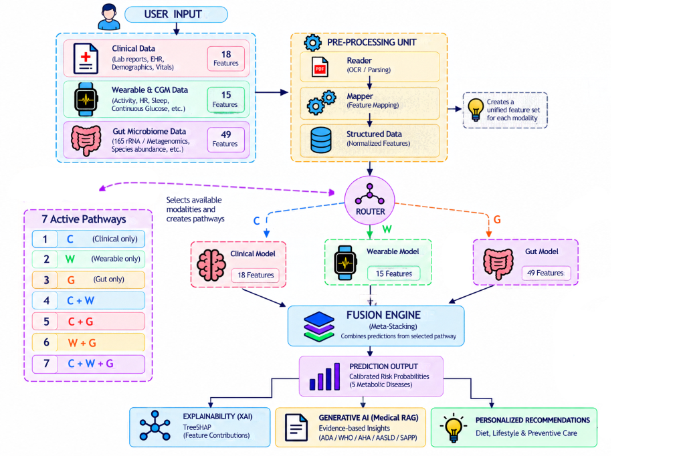

# TeleMed-M3: Dynamic Imputation-Free Multimodal Learning for Explainable Metabolic Disease Risk Stratification

**Abstract**
*Background:* Multimodal metabolic risk assessment may combine Clinical, Wearable/CGM, and Gut Microbiome information, but modality availability can vary greatly in practice. *Problem:* Conventional multimodal systems often require complete feature blocks or rely on numerical imputation when modalities are unavailable. *Method:* TeleMed-M3 uses modality-specific expert models and probability-level stacking across all seven non-empty modality combinations (C, W, G, C+W, C+G, W+G, C+W+G). *Dataset:* We evaluated this architecture on a 100,000-patient de-clamped probabilistic synthetic cohort (70/15/15 split). *Targets:* Type 2 Diabetes, Prediabetes, High Adiposity Risk, Metabolic Syndrome, and NAFLD. *Missingness:* Patient-level simulated modality loss at evaluated 10-30% levels. *Results:* Clinical was the strongest single modality across the five targets. Wearable+Gut retained measurable discrimination when Clinical was unavailable. Full multimodal gains over Clinical-only were modest. Dynamic routing remained operational under simulated patient-level missingness, producing numerically higher AUROCs than conventional imputation without establishing sweeping statistical superiority. Dynamic routing achieved comparable performance to conventional early fusion while preserving structural robustness. *Conclusion:* The primary contribution is modality-flexible, imputation-free probability-level routing under evaluated synthetic missingness conditions.

## 1. Introduction
Metabolic disease is highly multifactorial. Clinical measurements are strong predictive markers but may be unavailable at every encounter. Wearables provide longitudinal behavioral and physiological information, while the gut microbiome provides complementary biological information. However, multimodal systems face heterogeneous modality availability. Numerical imputation can introduce unwanted assumptions about unavailable modalities. Dynamic routing can instead operate strictly on the subset of available modality experts. This study evaluates simulated modality missingness.

## 2. Research Questions
**RQ1:** How does each modality independently discriminate the five metabolic risk targets in the de-clamped synthetic cohort?
**RQ2:** How does probability-level fusion perform across all seven non-empty modality combinations?
**RQ3:** Does multimodal fusion provide measurable incremental discrimination over Clinical-only prediction?
**RQ4:** Can the dynamic routing architecture maintain predictive performance under simulated patient-level modality missingness?
**RQ5:** How does dynamic routing compare with conventional modality imputation?
**RQ6:** How does probability-level dynamic routing compare with conventional early fusion?
**RQ7:** How can TreeSHAP and evidence-grounded Medical RAG support explainable risk reporting? (Exploratory framework).

## 3. Contributions
1. An imputation-free dynamic modality-routing architecture covering all seven non-empty modality configurations.
2. Modality-specific expert modeling for Clinical, Wearable/CGM, and Gut Microbiome data across five metabolic risk targets.
3. Out-of-fold probability-level stacking with reproducible Pipeline-based preprocessing.
4. Controlled evaluation under simulated patient-level modality missingness.
5. Comparison with conventional median-imputation and early-fusion baselines.
6. TreeSHAP and evidence-grounded Medical RAG reporting architecture, with quantitative evaluation clearly identified as future work.

## 4. Related Work
Multimodal systems in healthcare generally require complete feature vectors or rely heavily on imputation. Early fusion networks implicitly impute representations. Prior research on modality routing has proposed complex modular networks. Here, we evaluate probability-level meta-learners operating directly on available instantiated modality experts.

## 5. Dataset
The evaluation utilizes a "De-Clamped Probabilistic Synthetic Cohort". It comprises 100,000 patients with a 70/15/15 split. The dataset provides 18 Clinical features, 15 Wearable/CGM features, and 49 predictive Gut dimensions for five targets. The generative mechanism is a Gaussian-Copula latent structure.

### 5.1. Target Prevalence
The exact positive-class prevalence rates for the five targets in the evaluation cohort are: Type 2 Diabetes (52.61%), Prediabetes (20.01%), High Adiposity Risk (39.04%), Metabolic Syndrome (57.12%), and NAFLD (59.57%). Prevalence is an important contextual factor for interpreting AUPRC, as baseline random-chance AUPRC is equivalent to target prevalence. Therefore, AUPRC cannot be universally compared across targets with differing prevalences.

### 5.2. Deterministic Label-Feature Coupling Audit
An earlier generator version applied post-label deterministic clinical clamping to diagnostic variables. This created target-feature leakage. The perfect Clinical discrimination in the clamped cohort was attributable to deterministic label-feature coupling and therefore was not interpretable as generalizable predictive performance. Consequently, the clamping logic was removed. The completely de-clamped cohort was used for all final experiments.

## 6. Methodology

*Figure 1: TeleMed-M3 System Architecture depicting 18 Clinical, 15 Wearable/CGM, and 49 Gut Microbiome features, dynamic 7-pathway routing, meta-stacking fusion, 5 metabolic risk predictions, TreeSHAP explainability, and Medical RAG decision support.*

**A. Modality-specific experts:** Specialized models natively predicting based on C, W, or G.
**B. Preprocessing Pipelines:** Ensuring identical treatment across training and inference.
**C. OOF predictions:** Expert outputs for the training split used as meta-features.
**D. Probability-level stacking:** Combining expert probabilities.
**E. Seven modality pathways:** C, W, G, C+W, C+G, W+G, C+W+G.
**F. Dynamic routing:** Routing patient to the pathway representing their observed modalities. Unavailable modalities are not numerically imputed.
**G. Evaluation Metrics:** F1 scores were calculated using a fixed probability threshold of 0.5; threshold optimization was not performed.
**H. Simulated patient-level missingness:** The simulated modality-availability mechanism corresponds to Missing Completely At Random (MCAR) under the experimental construction, as modalities are removed via independent uniform probabilities. This mechanism is a controlled simulation and does not represent the informative missingness mechanisms that may occur in clinical workflows.
**I. Conventional imputation baseline:** Standard median imputation of the raw space.
**J. Early-fusion baseline:** Concatenating features before prediction.

## 7. Experimental Results

### Table I: 15 Expert Models
| Modality | Target | AUROC | AUPRC | F1 | Brier |
|---|---|---|---|---|---|
| Clinical | Type2_Diabetes | 0.7777 | 0.7810 | 0.7179 | 0.1921 |
| Wearable | Type2_Diabetes | 0.6772 | 0.6974 | 0.6474 | 0.2255 |
| Gut | Type2_Diabetes | 0.5949 | 0.6088 | 0.5485 | 0.2433 |
| Clinical | Prediabetes | 0.5839 | 0.2418 | 0.3550 | 0.2416 |
| Wearable | Prediabetes | 0.5429 | 0.2221 | 0.3155 | 0.2434 |
| Gut | Prediabetes | 0.5134 | 0.2092 | 0.2984 | 0.2475 |
| Clinical | High_Adiposity_Risk | 0.7532 | 0.6390 | 0.6362 | 0.2025 |
| Wearable | High_Adiposity_Risk | 0.6602 | 0.5395 | 0.5509 | 0.2306 |
| Gut | High_Adiposity_Risk | 0.5263 | 0.4111 | 0.4467 | 0.2494 |
| Clinical | Metabolic_Syndrome | 0.7581 | 0.7931 | 0.7164 | 0.2001 |
| Wearable | Metabolic_Syndrome | 0.6207 | 0.6708 | 0.6285 | 0.2388 |
| Gut | Metabolic_Syndrome | 0.5777 | 0.6321 | 0.5924 | 0.2454 |
| Clinical | NAFLD | 0.7743 | 0.8228 | 0.7378 | 0.1938 |
| Wearable | NAFLD | 0.5995 | 0.6781 | 0.6231 | 0.2422 |
| Gut | NAFLD | 0.6487 | 0.7180 | 0.6166 | 0.2336 |

### Table II: 7x5 AUROC Matrix
| Target | P1 (C) | P2 (W) | P3 (G) | P4 (C+W) | P5 (C+G) | P6 (W+G) | P7 (C+W+G) |
|---|---|---|---|---|---|---|---|
| Type2_Diabetes | 0.7777 | 0.6772 | 0.5949 | 0.7825 | 0.7788 | 0.6894 | 0.7834 |
| Prediabetes | 0.5839 | 0.5429 | 0.5134 | 0.5875 | 0.5840 | 0.5428 | 0.5875 |
| High_Adiposity_Risk | 0.7532 | 0.6602 | 0.5263 | 0.7547 | 0.7532 | 0.6607 | 0.7547 |
| Metabolic_Syndrome | 0.7581 | 0.6207 | 0.5777 | 0.7586 | 0.7581 | 0.6336 | 0.7586 |
| NAFLD | 0.7743 | 0.5995 | 0.6487 | 0.7745 | 0.7771 | 0.6621 | 0.7772 |

### Table III: Patient-Level Simulated Missingness (T2D)
| Target | Level | Dynamic AUROC | Conv. AUROC |
|---|---|---|---|
| T2D (Random) | 10% | 0.7803 | 0.7795 |
| T2D (Random) | 20% | 0.7777 | 0.7764 |
| T2D (Random) | 30% | 0.7743 | 0.7722 |

## 8. Results Interpretation
1. Clinical was the strongest single modality across all five targets.
2. W+G retained measurable discrimination for targets where Clinical was unavailable.
3. Full multimodal fusion produced only modest improvements over Clinical-only. 
4. Dynamic routing maintained performance under the evaluated simulated patient-level missingness scenarios.
5. Dynamic routing produced a numerically higher AUROC (0.7743) than the evaluated median-imputation baseline (0.7722) under the simulated 30% missingness condition. The absolute AUROC difference was 0.0021 (95% CI: [0.0001, 0.0041]). The magnitude of the difference was small. Dynamic routing was compared with the evaluated median-imputation baseline under the specified simulated missingness conditions. Other imputation strategies, including multiple-imputation (MICE) and learned generative approaches, were not evaluated.
6. Dynamic routing performs comparably to early fusion, with structural advantages.

## 9. Explainability
TreeSHAP is incorporated as an explanatory mechanism for feature-level attribution; a quantitative evaluation of explanation fidelity or clinician agreement remains outside the present experimental scope. Evidence-grounded Medical RAG converts probabilities to explanatory text contextually.

## 10. Limitations
1. All predictive results are derived entirely from the de-clamped synthetic cohort; no external real-world validation was performed.
2. No clinical efficacy or diagnostic utility is established.
3. The synthetic cohort relies on a Gaussian-Copula latent dependence structure and therefore may not capture the full range of nonlinear, higher-order, and context-dependent dependencies present in real physiological systems.
4. The simulated modality-availability mechanism corresponds to MCAR; this controlled simulation does not capture the Missing Not At Random (MNAR) or Missing At Random (MAR) mechanisms inherent in clinical workflows.
5. Threshold optimization/calibration for deployment-specific operating points was not evaluated for F1 scores.
6. Advanced iterative imputation methods (e.g., MICE) were not evaluated.

## 11. Conclusion
TeleMed-M3 provides a reproducible imputation-free probability-level routing framework that operates across seven non-empty modality configurations and maintains measurable discrimination under the evaluated simulated patient-level modality-missingness scenarios. 

## 12. Reproducibility
Pipeline artifacts, data manifest, and exact seeds are comprehensively retained. A preprocessing serialization discrepancy was corrected prior to final evaluation.
